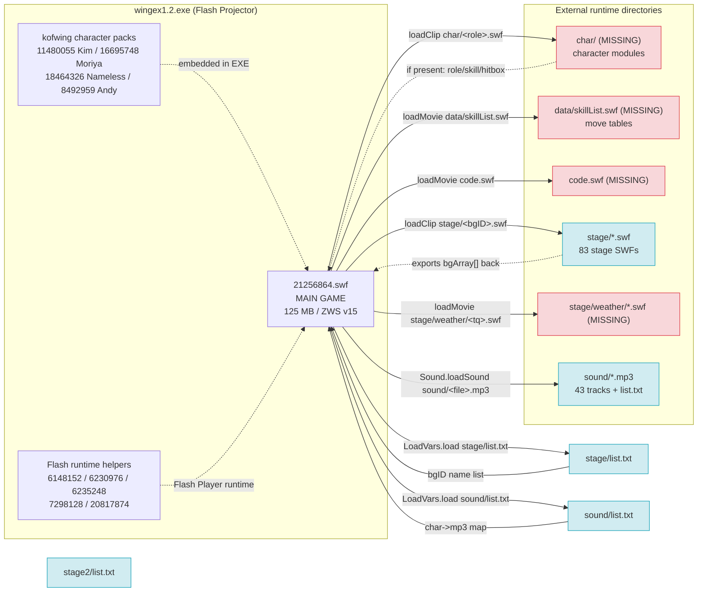

# SWF Dependency Graph - King of Fighters Wing EX1.2

Generated by `_reverse/tools/build_graph.py`. Machine-readable edges:
[`dependency_edges.csv`](dependency_edges.csv) · Mermaid source: [`dependency_graph.mmd`](dependency_graph.mmd)

## Confidence legend

| Grade | Meaning |
| --- | --- |
| **CONFIRMED** | A literal, non-concatenated path was passed to a loader call **and** the target exists on disk (or is a registry file we verified). |
| **PATTERN** | A literal directory/extension prefix that the game concatenates with a runtime variable. The *shape* of the dependency is proven by the code, but the exact filename cannot be resolved statically. |
| **MISSING** | Same evidence as PATTERN, but no file in this distribution can satisfy the path. |
| **INFERRED** | Indirect/dynamic reference, or a bare library link id with no path at all. |

## Graph



## Load chain, in execution order

1. **Projector boots** → the runtime plays the movie appended at the end of the EXE. That movie is
   `kofwing/21256864.swf`, found at EXE offset **21,256,864**, signature `ZWS` (LZMA), SWF v15.
   Its filename in this extraction *is* its byte offset.

2. **Stage registry load**
   `analysis/kofwing__21256864/scripts/scripts/DefineSprite_61566/frame_4/DoAction.as:8`
   ```actionscript
   bgInf.load("stage/list.txt");
   ```
   On success (`DefineSprite_61566/frame_1/DoAction.as:3-4`):
   ```actionscript
   stageArray = bgInf.stageBG.split(",");
   _level0.bgArray = stageArray.concat();
   ```
   Note the **name collision**: `_level0.bgArray` first holds an array of *stage name strings*,
   and is later overwritten with the *layer objects* exported by the loaded stage SWF.

3. **Music registry load**
   `DefineSprite_1847_bgmControl_mc/frame_4/DoAction.as:4`
   ```actionscript
   soundInf.load("sound/list.txt");
   ```

4. **BGM playback** - `DefineSprite_1847_bgmControl_mc/frame_1/DoAction.as`
   ```actionscript
   function loadSound(char, chars) {
      var _loc2_ = soundInf[char];          // key from sound/list.txt, e.g. "Iori3"
      ...
      stageSound.loadSound("sound/" + _loc2_, false);
   }
   ```
   `init()` also sweeps `soundInf["stage0"], ["stage1"] ...` into `soundArray`, giving
   per-stage music slots. A silent `Sound` object named `stageSound` plays the result, and
   `onLoad` failure falls back to `this.attachSound("blank")`.
   Volume comes from `_level0.BgmVolume`.

5. **Stage SWF load**
   `scripts/scripts/frame_1638/DoAction.as:67` and `DefineSprite_2659/frame_1/DoAction.as:29`
   ```actionscript
   stage_loader.loadClip("stage/" + bgID + ".swf", stage_mc);
   ```

6. **Stage module hands its layers back**
   `scripts/scripts/__Packages/Stage_control2.as:76`
   ```actionscript
   this.bgObjArray = this.bgSource.bgArray;
   ```
   Every stage SWF exports a global `bgArray` of parallax layers, e.g. `stage2/Kyo.swf`:
   ```actionscript
   stop();
   var bgArray = [{isBmd:false, mc:bg0_mc, v_rate:1, isBase:true}];
   ```
   Layer record fields: `isBmd` (bitmap layer), `mc` (MovieClip reference),
   `v_rate` (vertical scroll/parallax rate), `isBase` (base layer anchor).

7. **Character module load**
   `scripts/scripts/frame_1629/DoAction.as:792, 812, 915, 919`
   ```actionscript
   _loc2_.loadClip("char/" + _loc1_ + ".swf", P1_mc);
   P1_mc.loadMovie("char/" + roleName + ".swf");
   ```
   `P1_mc._lockroot = true` is set first, which is how the loaded character module addresses
   the game through `_root`/`_level0`.

8. **Move table load**
   `DefineSprite_60324/frame_1/DoAction.as:14-24`
   ```actionscript
   var skList = createEmptyMovieClip("skillList",0);
   loadMovie("data/skillList.swf",skList);
   ... skList.currentName = _level0.charSelect_P1;
       skList.currentMode = _level0.mode_role_P1;
       skList.onLoadSkill();
   ```

9. **Weather overlay**
   `DefineSprite_3266/frame_1/DoAction.as:1`
   ```actionscript
   this.loadMovie("stage/weather/" + _root.tq + ".swf");
   ```
   `_root.tq` is set by stage modules; `stage2/Haohmaru.swf` sets `_root.tq = "raining"`.

## Confirmed edges

| Source | Target | API | Location |
| --- | --- | --- | --- |
| `kofwing/21256864.swf` | `stage/list.txt` | `LoadVars.load` | `DefineSprite_61566/frame_4/DoAction.as:8` |
| `kofwing/21256864.swf` | `sound/list.txt` | `LoadVars.load` | `DefineSprite_1847_bgmControl_mc/frame_4/DoAction.as:4` |
| `kofwing/21256864.swf` | `sound/main.mp3` | `Sound.loadSound` | `frame_1629/DoAction.as:3413` |
| `kofwing/21256864.swf` | `sound/select.mp3` | `Sound.loadSound` | `DefineSprite_2732_char_select_mc/frame_2/DoAction.as:12` |

## Pattern edges (prefix proven, filename is runtime)

| Source | Pattern | API | Location |
| --- | --- | --- | --- |
| `kofwing/21256864.swf` | `stage/<bgID>.swf` | `MovieClipLoader.loadClip` | `frame_1638/DoAction.as:67` |
| `kofwing/21256864.swf` | `stage/<bgID>.swf` | `MovieClipLoader.loadClip` | `DefineSprite_2659/frame_1/DoAction.as:29` |
| `kofwing/21256864.swf` | `char/<roleName>.swf` | `loadMovie` / `loadClip` | `frame_1629/DoAction.as:792,812,915,919` |
| `kofwing/21256864.swf` | `sound/<registry value>` | `Sound.loadSound` | `bgmControl_mc/frame_1/DoAction.as:48,52` |
| `kofwing/21256864.swf` | `stage/weather/<tq>.swf` | `loadMovie` | `DefineSprite_3266/frame_1/DoAction.as:1` |

## Missing dependencies (proven by code, absent from this distribution)

| Source | Path | API | Evidence |
| --- | --- | --- | --- |
| `kofwing/21256864.swf` | `char/<role>.swf` | `loadClip`/`loadMovie` | `frame_1629/DoAction.as:792,812,915,919` |
| `kofwing/21256864.swf` | `data/skillList.swf` | `loadMovie` | `DefineSprite_60324/frame_1/DoAction.as:15` |
| `kofwing/21256864.swf` | `code.swf` | `loadMovie` | `frame_1629/DoAction.as:3541` |
| `kofwing/21256864.swf` | `stage/weather/<tq>.swf` | `loadMovie` | `DefineSprite_3266/frame_1/DoAction.as:1` |
| `kofwing/20817874.swf` | `debug/debug.swf` | `loadMovie` | Flash debug UI - optional |
| `kofwing/21256864.swf` | `http://flashwing.kilu.de/help.html#<role>` | dynamic | remote help URL |

**This is the single most important practical finding:** the game cannot run a full match from
this tree alone. `char/`, `data/skillList.swf`, `code.swf` and `stage/weather/` are required at
runtime and are not present. If the game currently launches, those files must exist in a separate
install location, or the launch succeeds but stages/characters fail to load.

## Reverse edges (stage SWF → main program)

Stage SWFs are pure data providers; they make no outbound calls. They push state *inward*:

| Stage module | Publishes |
| --- | --- |
| all 83 stage SWFs | `bgArray[]` of `{isBmd, mc, v_rate, isBase}` |
| `stage2/Haohmaru.swf` | `_root.raining = true`, `_root.tq = "raining"`, `this.blendMode = "add"` |
| `stage2/E_Ash.swf` | `blackAsh = true` |
| `stage2/Ryu.swf` | reads `_level0.glowMode`, drives a fading `blendMode="add"` overlay |
| most stage SWFs | `System.security.allowDomain("*")` |

## Stage registry resolution

`stage/list.txt` declares 20 backgrounds in its `stageBG` line. **All 20 resolve** to real files in
`stage/` (Chinese filenames), and the loader reads `stage/` - so these work today.

The same file's character→stage mappings are a different story. Of the 30 character entries,
only 11 names match any file in the tree, and they match files under `stage2/其他地图/静态/`
and `stage2/其他地图/动态/`, **not** under `stage/`:

| Key | Declared | Only copy found |
| --- | --- | --- |
| Kyo | Railway | `stage2/其他地图/静态/Railway.swf` |
| Moriya | Moon | `stage2/其他地图/静态/Moon.swf` |
| Mai | Platform | `stage2/其他地图/静态/Platform.swf` |
| Athena | piazza | `stage2/其他地图/静态/piazza.swf` |
| Nameless | Lab | `stage2/其他地图/静态/Lab.swf` |
| Ryo | Japan | `stage2/其他地图/动态/Japan.swf` |
| Orochi | earth | `stage2/其他地图/动态/earth.swf` |
| Zero | Zero | `stage2/Zero.swf` (a character module - name collision) |
| Zero2 | cZero | `stage2/CZero.swf` (a character module - name collision) |
| Kusanagi | cloneTeam | `stage2/CloneTeam.swf` (a character module - name collision) |
| Orochi2 | Mizuchi | `stage2/Mizuchi.swf` (a character module - name collision) |

The loader is unambiguous - `DefineSprite_2659/frame_1/DoAction.as:29`:

```actionscript
_loc2_.loadClip("stage/" + bgID + ".swf", loader);
```

There is **no** multi-directory search and **no** fallback: the path is always `stage/<name>.swf`.
So for the seven `其他地图` rows above, `loadClip("stage/Railway.swf")` will fail unless the file
has been copied into `stage/` at runtime. The remaining 19 entries (`iceLab`, `Factory`,
`Moon bridge`, `Gym`, `China`, `America`, `Snow`, `Church14`, ...) reference English filenames
that exist nowhere in this distribution at all.

Two readings are possible and I cannot settle them from static analysis alone:
- the `其他地图` files are an optional EX1.2 bonus set that the player copies into `stage/`
  manually, or the shipped `list.txt` is out of date and those mappings are simply broken.

**Open question for the owner:** confirm whether `stage2/其他地图/*` is meant to be copied into
`stage/` before playing, or whether a newer `list.txt` is expected.

`sound/list.txt` resolves completely: 41 of 41 file entries exist (including the case-sensitive
`ChunLi.MP3` and lowercase `Iori3.mp3`), plus one config scalar `musicNum=50`.
Note `musicNum=50` advertises 50 tracks while only 43 MP3 files exist.

## `stage2/` is not referenced by the main program

A full-text search of the boot movie's exported ActionScript and its extracted string table for
`stage2` returns **zero hits**. The main program loads only `stage/list.txt` and then
`stage/<name>.swf`. Consequently:

- `stage2/list.txt` is never read by the code in `21256864.swf`.
- No file in `stage2/` is reachable through any loader call in the boot movie.

This is a confirmed absence of evidence, not merely a failure to find it. The practical reading is
that `stage2/` is an EX1.2 add-on whose integration was either never wired into the boot movie, or
is handled by a newer `list.txt` than the one shipped here.